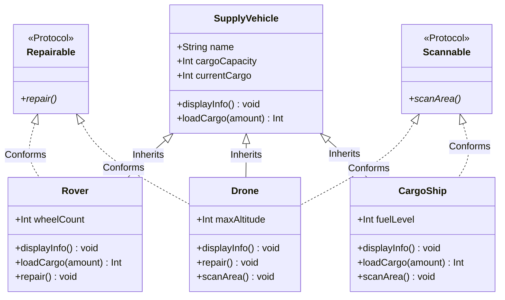

# Swift POP: Protocol-Oriented Fleet System

[](https://swift.org)
[](https://apple.com)
[](LICENSE)
[](Package.swift)

An advanced Swift architecture demonstrating **Protocol-Oriented Programming (POP)**, class inheritance, multiple protocol conformance, conditional runtime type casting (`as?`), and polymorphic behavior simulation in a space colony supply network.

---

## 🚀 Key Competencies & Skills Demonstrated

- **Protocol-Oriented Programming (POP)**: Defining decoupled, reusable behavioral contracts (`Repairable`, `Scannable`) that classes can adopt independently.
- **Multiple Protocol Conformance**: Designing composable entities (e.g., `Drone`) conforming to multiple protocols simultaneously (`Repairable & Scannable`).
- **Conditional Downcasting & Runtime Type Inspection**: Utilizing `as?` to dynamically query and execute protocol-conforming capabilities across heterogeneous polymorphic collections (`[SupplyVehicle]`).
- **Domain Specialization & Method Overriding**: Implementing custom cargo capacity policies and safety thresholds across distinct vehicles (e.g., fuel-restricted loading in `CargoShip`).
- **Interactive State-Driven CLI**: Managing terminal input loops with safe parsing and defensive flow controls.

---

## 🏛️ Architecture & Protocol Matrix



### Protocol Conformance Overview

| Vehicle Class | Base Class | `Repairable` | `Scannable` | Special Behaviors |
| :--- | :--- | :---: | :---: | :--- |
| **Rover** | `SupplyVehicle` | ✅ | ❌ | Terrain bumping simulation; custom repair logic |
| **CargoShip** | `SupplyVehicle` | ❌ | ✅ | Fuel threshold check ($<20\%$ limits cargo to $50\%$) |
| **Drone** | `SupplyVehicle` | ✅ | ✅ | Altitude aerial scanning & propeller calibration |

---

## 🔍 Core POP Code Highlights

### Dynamic Capability Querying via Conditional Downcasting
```swift
for vehicle in fleet {
    vehicle.displayInfo()
    _ = vehicle.loadCargo(amount: 15)
    
    // Dynamic Protocol Inspection
    if let repairable = vehicle as? Repairable {
        repairable.repair()
    } else {
        print("  (Not repairable)")
    }
    
    if let scannable = vehicle as? Scannable {
        scannable.scanArea()
    } else {
        print("  (Not scannable)")
    }
}
```

### Safety-Critical Subclass Overriding
```swift
class CargoShip: SupplyVehicle, Scannable {
    var fuelLevel: Int
    
    override func loadCargo(amount: Int) -> Int {
        if fuelLevel < 20 {
            print("  ⚠️ Low fuel! Restricting load to 50% capacity for safety.")
            let halfCapacity = cargoCapacity / 2
            let spaceLeft = halfCapacity - currentCargo
            return super.loadCargo(amount: min(amount, spaceLeft))
        }
        return super.loadCargo(amount: amount)
    }
    
    func scanArea() {
        print("  🛰️ \(name) scanning for orbital landing zones.")
    }
}
```

---

## 📂 Repository Structure

```tree
swift-protocol-oriented-fleet-system/
├── Sources/
│   ├── SupplyVehicle.swift         # Base parent class with core cargo mechanics
│   ├── Repairable.swift            # Maintenance protocol definition
│   ├── Scannable.swift             # Planetary scanning protocol definition
│   ├── Rover.swift                 # Ground vehicle (Repairable)
│   ├── Drone.swift                 # Aerial vehicle (Repairable & Scannable)
│   ├── CargoShip.swift             # Heavy transport (Scannable)
│   └── main.swift                  # Polymorphic loop & interactive CLI runner
├── ColonyFleetManager.xcodeproj/   # Xcode project configuration
├── Package.swift                   # Swift Package Manager manifest
├── .gitignore                      # Xcode / SPM exclusion rules
├── LICENSE                         # MIT Open Source License
└── README.md                       # Project documentation
```

---

## 💻 Interactive Terminal CLI Preview

```text
--- Welcome to the Space Colony Supply Network ---

Menu Options:
=============================
1) Create Rover
2) Create Drone
3) Create Cargo Ship
4) View All Vehicles
5) Load Cargo onto a Vehicle
6) Run Vehicle Actions (Override/Protocols)
7) Exit

Please select an option: 6

--- Running Behaviours ---
👉 Lunar Scout
Vehicle Name: Lunar Scout
  Capacity: 500 kg
  Current Load: 0 kg
  Type: Aerial Drone (Max Alt: 2500 m)
  [Test loading 15 kg...]
  Loaded 15 kg onto Lunar Scout.
  🛸 Calibrating the propellers on Lunar Scout.
  📡 Lunar Scout is scanning the planet surface from 2500 meters up.
```

---

## 🛠️ How to Run & Build

### Using Swift Package Manager (CLI)
```bash
# Build executable
swift build

# Run interactive simulation
swift run
```

### Using Xcode
1. Open `ColonyFleetManager.xcodeproj` or open the directory in Xcode.
2. Select target `ColonyFleetManager` and press `Cmd + R` to run in Xcode Terminal.

---

## 📄 License

This project is licensed under the [MIT License](LICENSE).
